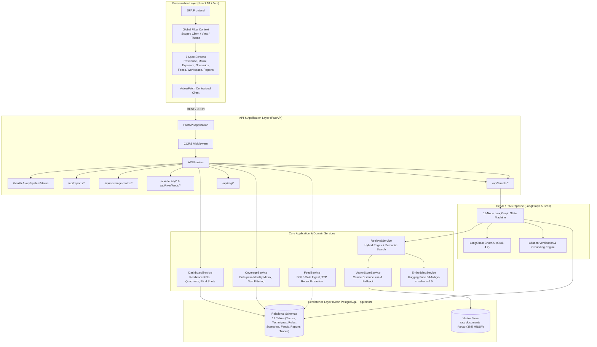

# ITDR Platform Architecture

## Executive Summary
The Identity Threat Detection & Response (ITDR) Platform is an enterprise-grade cybersecurity intelligence platform designed to quantify an organization's defensive coverage against identity-centric cyber threats, ingest threat intelligence, and generate grounded, explainable threat modeling reports.

The platform couples an **Active Knowledge Base** (ingested from official MITRE ATT&CK® Enterprise STIX 2.1 and MITRE D3FEND™ ontologies) with a **Stateful LangGraph GenAI Agent Workflow**, backed by **xAI Grok** for generation, **Hugging Face Inference** for embeddings, and **Neon PostgreSQL with pgvector** for hybrid relational and vector storage.

---

## High-Level System Architecture

---

## Architectural Layers

### 1. Presentation Layer (Frontend)
- **Framework**: React 18, Vite bundling, vanilla JavaScript (JSX), and modern responsive CSS tokens.
- **Routing**: `react-router-dom` v6 mapping the 7 specification screens:
  1. `/` or `/dashboard`: Identity Resilience Dashboard
  2. `/coverage-matrix`: ITDR Coverage Matrix (Identity vs. Enterprise, tool toggles)
  3. `/threat-exposure`: Identity Threat Exposure (sighted TTPs by attack phase)
  4. `/threat-scenarios`: Identity Threat Scenarios (resilience quadrant & scenario cards)
  5. `/feeds`: Threat Intelligence Feeds (CTI bulletins, SSRF-safe ingest modal)
  6. `/threat-modeling`: Threat Modeling Workspace (3-step AI journey: Advisory Input $\rightarrow$ Model Selection $\rightarrow$ Observable Trace & Report)
  7. `/completed-reports`: Completed Intelligence Reports (audit history, Markdown/JSON export)
- **State Management**:
  - `FilterContext`: Manages global top-bar controls (View Mode: `ClientReq`/`MVP1`/`MVP2`/`MVP3`, Client Restriction: `ALL`/`Client Restricted`/`Unrestricted`, ITDR Scope: `ALL`/`ITDR Scope Only`/`Non-ITDR`, Theme: `light`/`dark`).
  - Broadcasts filter parameters to API endpoints automatically.
- **Shared API Client (`client.js`)**:
  - Encapsulates error handling, base URL resolution, and parameter normalization.
  - Guarantees no raw URLs are hard-coded inside components.

### 2. Service & API Layer (Backend)
- **Framework**: Python 3.12 + FastAPI.
- **Data Validation & Schemas**: Pydantic v2 schemas for request validation and response serialization.
- **Database Engine**: SQLAlchemy 2.0 ORM with connection pooling, statement caching, and declarative models.
- **Migrations**: Alembic with full version control (`alembic/versions/`).
- **Security Boundaries**:
  - Strict Server-Side Request Forgery (SSRF) validation on external feed ingest URLs (blocks loopbacks, private RFC1918 subnets, cloud metadata endpoints `169.254.169.254` and `metadata.google.internal`).
  - Zero client-side credential exposure (xAI API key, Hugging Face tokens, and database credentials remain strictly within backend environment variables).
  - Dual-mode resilient database abstraction: automatically utilizes native pgvector HNSW indices on Neon cloud instances, with graceful fallback to in-memory cosine ranking when running against local development databases without native C extensions.

### 3. Knowledge Ingestion & Synchronization
- **MITRE ATT&CK STIX 2.1**:
  - Ingests official Enterprise ATT&CK objects: Tactics (`x-mitre-tactic`), Techniques (`attack-pattern`), Sub-techniques, Software/Groups, and Procedure relationships (`relationship` of type `uses`).
  - Heuristic classifier assigns `is_identity_relevant` based on credential access, privilege escalation, defense evasion, Active Directory, Kerberos, OAuth, SAML, and MFA vectors.
- **MITRE D3FEND**:
  - Ingests D3FEND defensive ontology: Defenses, Tactics, Artifacts, and official mappings linking ATT&CK offensive techniques to D3FEND defensive countermeasures.
- **Document Chunking & Vectorization**:
  - `DocumentBuilderService` creates standardized semantic documents (`RagDocument`) with full provenance metadata.
  - Content hashing (SHA-256) ensures 100% idempotent upserts.

### 4. GenAI & Explainable RAG Architecture
- **LangGraph State Machine**:
  - Replaces rigid linear chains with a stateful 11-node directed execution graph.
  - Implements state validation, explicit regex indicator extraction, hybrid context retrieval, prompt construction, Grok-4.7 structured generation, citation verification, and automated fallback.
- **Anti-Hallucination & Grounding**:
  - RAG retrieves verified technique definitions and official D3FEND countermeasures.
  - Grok is prompted with strict instruction to cite only verified ATT&CK IDs and retrieved D3FEND items.
  - Post-generation validation cross-references citations against the retrieved candidate set and strips or flags hallucinated identifiers.

---

## Data Flow: End-to-End Threat Modeling Analysis

```mermaid
sequenceDiagram
    autonumber
    actor Analyst as Security Analyst
    participant UI as React Frontend
    participant API as FastAPI Threat Router
    participant LG as LangGraph Workflow
    participant Ret as Retrieval Engine
    participant VS as Vector Store (Neon pgvector)
    participant Grok as xAI Grok-4.7 LLM
    participant DB as PostgreSQL DB

    Analyst->>UI: Submit Threat Advisory (e.g. "Adversaries abused T1078.004 to bypass MFA...")
    UI->>API: POST /api/threats/analyze { advisory_text, model, temperature }
    API->>LG: Initialize ThreatAnalysisState & Invoke Workflow
    
    rect rgb(20, 30, 50)
        Note over LG: Step 1-2: Validate Input & Extract Indicators
        LG->>LG: Extract explicit T-IDs (T1078.004, T1003) & keywords
    end

    rect rgb(20, 40, 60)
        Note over LG: Step 3-6: Hybrid Semantic & Structural Retrieval
        LG->>Ret: Query Context (Extracted IDs + Query Embedding)
        Ret->>VS: Cosine Similarity (<=>) + Exact ID Boost
        VS-->>Ret: Candidate Techniques & Metadata
        Ret->>DB: Query Mapped D3FEND Countermeasures & Detection Rules
        DB-->>Ret: Defensive Capabilities
        Ret-->>LG: Deduplicated, Ranked Context Window
    end

    rect rgb(30, 20, 50)
        Note over LG: Step 7-9: Grounded Generation & Citation Verification
        LG->>Grok: Prompt with strict context, schema, and citation instructions
        Grok-->>LG: Structured JSON Report
        LG->>LG: Validate Citations against Candidate Set (Zero Hallucination)
    end

    rect rgb(20, 50, 40)
        Note over LG: Step 10-11: Persistence & Observable Trace Recording
        LG->>DB: Persist ThreatAnalysisReport, AnalysisCitation, AnalysisTraceStep
        DB-->>LG: Commit transaction
    end

    LG-->>API: Completed Report with 11 Trace Steps & Citations
    API-->>UI: 200 OK (Report JSON + Trace Stepper Payload)
    UI-->>Analyst: Render Executive Summary, TTP Matrix, D3FEND Defenses, Trace Stepper
```

