# ITDR Platform Database Schema

## Overview
The ITDR Platform database is designed for **hybrid relational and vector storage** in **PostgreSQL 16+ / Neon**. It manages MITRE ATT&CK enterprise knowledge, MITRE D3FEND defensive countermeasures, active security detection rules, threat scenarios, threat intelligence feeds, generated threat reports, and full execution trace telemetry.

---

## Entity-Relationship Diagram (ERD)

```mermaid
erDiagram
    ATTACK_TACTIC ||--o{ ATTACK_TECHNIQUE_TACTIC : categorizes
    ATTACK_TECHNIQUE ||--o{ ATTACK_TECHNIQUE_TACTIC : belongs_to
    ATTACK_TECHNIQUE ||--o{ ATTACK_TECHNIQUE : has_subtechnique
    ATTACK_TECHNIQUE ||--o{ ATTACK_PROCEDURE : demonstrated_by
    ATTACK_TECHNIQUE ||--o{ DETECTION_RULE_TECHNIQUE : covered_by
    DETECTION_RULE ||--o{ DETECTION_RULE_TECHNIQUE : maps_to
    
    ATTACK_TECHNIQUE ||--o{ D3FEND_MAPPING : countered_by
    D3FEND_TECHNIQUE ||--o{ D3FEND_MAPPING : defends_against
    D3FEND_TACTIC ||--o{ D3FEND_TECHNIQUE : organizes

    THREAT_SCENARIO ||--o{ THREAT_SCENARIO_TECHNIQUE : involves
    ATTACK_TECHNIQUE ||--o{ THREAT_SCENARIO_TECHNIQUE : featured_in

    THREAT_FEED ||--o{ RAG_DOCUMENT : vectorized_as
    ATTACK_TECHNIQUE ||--o{ RAG_DOCUMENT : vectorized_as
    D3FEND_TECHNIQUE ||--o{ RAG_DOCUMENT : vectorized_as

    THREAT_ANALYSIS_REPORT ||--o{ ANALYSIS_CITATION : references
    THREAT_ANALYSIS_REPORT ||--o{ ANALYSIS_TRACE_STEP : records_execution
    THREAT_FEED ||--o{ THREAT_ANALYSIS_REPORT : analyzed_from

    ATTACK_TACTIC {
        string id PK "e.g. TA0006"
        string name "Credential Access"
        string short_name "credential-access"
        text description
        string external_url
    }

    ATTACK_TECHNIQUE {
        string id PK "e.g. T1078 or T1078.004"
        string name "Valid Accounts"
        string parent_id FK "e.g. T1078"
        text description
        boolean is_subtechnique
        boolean is_identity_relevant
        string identity_domain
        string detection_difficulty
        string external_url
    }

    DETECTION_RULE {
        uuid id PK
        string rule_name
        string tool_source "CrowdStrike, MDI, Okta, Wiz, In-House, Third-Party"
        string rule_type "SIEM, EDR, Identity, Cloud"
        string query_logic
        string severity "Critical, High, Medium, Low"
        boolean is_active
        boolean is_demo_data
    }

    DETECTION_RULE_TECHNIQUE {
        uuid id PK
        uuid rule_id FK
        string technique_id FK
        string coverage_depth "Full, Partial, Telemetry Only"
        float confidence_score
    }

    D3FEND_TECHNIQUE {
        string id PK "e.g. D3-MFA"
        string name "Multi-factor Authentication"
        string tactic_id FK
        text description
        string d3fend_type "Defensive Technique"
    }

    D3FEND_MAPPING {
        uuid id PK
        string attack_technique_id FK
        string d3fend_technique_id FK
        string relationship_type "counters, detects, isolates"
    }

    THREAT_SCENARIO {
        uuid id PK
        string scenario_id UK "e.g. SCEN-001"
        string name
        string threat_actor
        float impact_score "1.0 - 10.0"
        float likelihood_score "1.0 - 10.0"
        float resilience_score "0.0 - 100.0"
        string status "Exposed, Partially Mitigated, Resilient"
    }

    THREAT_FEED {
        uuid id PK
        string bulletin_id UK "e.g. CTI-2026-001"
        string title
        string source
        string external_url
        string severity
        text content
        json indicators
        string status "New, Analyzed, Review"
    }

    RAG_DOCUMENT {
        uuid id PK
        string source_id "e.g. T1078.004 or D3-MFA"
        string source_kind "attack, d3fend, feed, procedure"
        string title
        text content
        json metadata_
        string content_hash UK "SHA-256 for idempotency"
        vector embedding "vector(384)"
    }

    THREAT_ANALYSIS_REPORT {
        uuid id PK
        string title
        string executive_summary
        string threat_actor
        string overall_risk_score
        float confidence_score
        json identified_ttps
        json recommended_d3fend
        json immediate_actions
        json strategic_actions
        json execution_trace_summary
        uuid source_feed_id FK
    }

    ANALYSIS_CITATION {
        uuid id PK
        uuid report_id FK
        string source_id "e.g. T1078.004"
        string source_type "ATT&CK, D3FEND, CTI Feed"
        string citation_text
        float relevance_score
    }

    ANALYSIS_TRACE_STEP {
        uuid id PK
        uuid report_id FK
        int step_index "0 to 10"
        string node_name "e.g. retrieve_attack_context"
        string status "success, skipped, failed"
        float latency_ms
        json input_payload
        json output_payload
    }
```

---

## Detailed Table Reference

### Knowledge Base Tables

#### 1. `attack_tactics`
Stores the 14-15 top-level MITRE ATT&CK Enterprise tactical objectives.
- `id` (VARCHAR(32), Primary Key): e.g., `TA0001` (Initial Access), `TA0006` (Credential Access).
- `name` (VARCHAR(255), Not Null): Human-readable tactic name.
- `short_name` (VARCHAR(100), Indexed): Normalized slug (e.g. `credential-access`).
- `description` (TEXT): Full tactical scope definition from MITRE STIX.
- `external_url` (VARCHAR(512)): Link to official MITRE ATT&CK website.

#### 2. `attack_techniques`
Stores all ATT&CK techniques and sub-techniques (800+ records).
- `id` (VARCHAR(32), Primary Key): Technique ID, e.g., `T1078` or `T1078.004`.
- `name` (VARCHAR(255), Not Null): Technique name.
- `parent_id` (VARCHAR(32), ForeignKey `attack_techniques.id`, Nullable): Populated for sub-techniques.
- `description` (TEXT): Description narrative.
- `is_subtechnique` (BOOLEAN, Default False): Flag indicating granular sub-technique.
- `is_identity_relevant` (BOOLEAN, Indexed, Default False): Calculated classifier flag identifying Active Directory, Kerberos, Cloud IAM, OAuth, Credential Access, and Privilege Escalation TTPs.
- `identity_domain` (VARCHAR(100)): E.g., `Active Directory`, `Cloud IAM`, `SSO/SAML`, `Endpoint LSASS`.
- `detection_difficulty` (VARCHAR(50)): E.g., `Low`, `Moderate`, `High`, `Very High`.

#### 3. `attack_technique_tactics`
Many-to-many junction connecting techniques to tactics.
- `technique_id` (VARCHAR(32), ForeignKey `attack_techniques.id`, PK component).
- `tactic_id` (VARCHAR(32), ForeignKey `attack_tactics.id`, PK component).

#### 4. `attack_software_groups`
Stores threat actors (e.g. `APT29`, `Scattered Spider`) and tools (e.g. `Mimikatz`, `BloodHound`).
- `id` (VARCHAR(64), Primary Key): STIX or MITRE ID.
- `name` (VARCHAR(255), Not Null): Actor or tool name.
- `kind` (VARCHAR(50)): `group`, `malware`, or `tool`.
- `aliases` (JSON): Synonyms and threat actor names used across different CTI vendors.

#### 5. `attack_procedures`
Stores specific in-the-wild procedure examples demonstrating how actors employ techniques.
- `id` (VARCHAR(64), Primary Key): Procedure identifier.
- `technique_id` (VARCHAR(32), ForeignKey `attack_techniques.id`): Target technique.
- `source_name` (VARCHAR(255)): Source actor or malware name.
- `description` (TEXT): Specific observable execution pattern.

#### 6. `d3fend_tactics` & `d3fend_techniques`
Stores the MITRE D3FEND defensive ontology.
- `d3fend_techniques.id` (VARCHAR(64), PK): e.g., `D3-MFA`, `D3-URBL`.
- `name` (VARCHAR(255)): Defensive technique name.
- `tactic_id` (VARCHAR(64)): Parent defensive objective (e.g., `Credential Hardening`, `User Behavior Analysis`).

#### 7. `d3fend_mappings`
Official linkages connecting offensive ATT&CK techniques with defensive D3FEND countermeasures.
- `id` (UUID, Primary Key).
- `attack_technique_id` (VARCHAR(32), ForeignKey `attack_techniques.id`, Indexed).
- `d3fend_technique_id` (VARCHAR(64), ForeignKey `d3fend_techniques.id`, Indexed).
- `relationship_type` (VARCHAR(50)): E.g., `counters`, `detects`, `mitigates`.

---

### Coverage & Resilience Posture Tables

#### 8. `detection_rules`
Defensive rules active across deployed enterprise security tools.
- `id` (UUID, Primary Key).
- `rule_name` (VARCHAR(255), Not Null): Rule identifier / title.
- `tool_source` (VARCHAR(100), Indexed): Tool provider: `CrowdStrike`, `Defender for Identity`, `Okta`, `Wiz`, `In-House`, `Third-Party`.
- `rule_type` (VARCHAR(50)): Category (`EDR`, `Identity`, `SIEM`, `Cloud`).
- `query_logic` (TEXT): Search query or detection pseudocode.
- `severity` (VARCHAR(50)): `Critical`, `High`, `Medium`, `Low`.
- `is_active` (BOOLEAN, Default True): Indicates whether rule is in production.
- `is_demo_data` (BOOLEAN, Default True): Clearly flags synthetic seed records.

#### 9. `detection_rule_techniques`
Junction mapping active rules to specific ATT&CK techniques.
- `id` (UUID, Primary Key).
- `rule_id` (UUID, ForeignKey `detection_rules.id`).
- `technique_id` (VARCHAR(32), ForeignKey `attack_techniques.id`).
- `coverage_depth` (VARCHAR(50)): `Full`, `Partial`, `Telemetry Only`.
- `confidence_score` (FLOAT): 0.0 to 1.0 confidence.
- *Constraint*: `UniqueConstraint("rule_id", "technique_id")` ensures no duplicate mapping rows.

#### 10. `threat_scenarios` & `threat_scenario_techniques`
Stores composite multi-stage threat scenarios displayed in Screen 4.
- `scenario_id` (VARCHAR(64), Unique): E.g., `SCEN-001`.
- `impact_score` & `likelihood_score` (FLOAT): Coordinates for the Resilience 2D Quadrant.
- `resilience_score` (FLOAT): Formula-derived coverage rating ($0 - 100\%$).
- `status` (VARCHAR(50)): `Exposed`, `Partially Mitigated`, `Resilient`.

---

### Vector Knowledge Base & GenAI Intelligence Tables

#### 11. `rag_documents`
The unified vector repository for semantic similarity search.
- `id` (UUID, Primary Key).
- `source_id` (VARCHAR(64), Indexed): Foreign key or source reference (e.g. `T1078.004`).
- `source_kind` (VARCHAR(50), Indexed): `attack`, `d3fend`, `feed`, `procedure`.
- `title` (VARCHAR(512), Not Null): Human-readable document title.
- `content` (TEXT, Not Null): Chunked textual narrative embedded into the vector space.
- `metadata_` (JSON): Extended structured properties (tactics, platforms, indicators).
- `content_hash` (VARCHAR(64), Unique, Indexed): SHA-256 hash of content ensuring idempotent upserts.
- `embedding` (`vector(384)`): 384-dimensional vector representation produced by `BAAI/bge-small-en-v1.5`.
- *Neon Index*: An HNSW cosine index `ix_rag_documents_embedding_hnsw` is automatically configured on Neon using `vector_cosine_ops`.

#### 12. `threat_feeds`
Stores ingested Cyber Threat Intelligence (CTI) advisories, bulletins, and security alerts.
- `id` (UUID, Primary Key).
- `bulletin_id` (VARCHAR(64), Unique, Indexed): E.g., `CTI-2026-001`.
- `title` (VARCHAR(512), Not Null): Advisory title.
- `source` (VARCHAR(255)): Advisory origin (e.g., `CISA Alert`, `Microsoft Threat Intel`).
- `external_url` (VARCHAR(1024), Nullable): SSRF-validated external reference.
- `severity` (VARCHAR(50)): `Critical`, `High`, `Medium`, `Low`.
- `content` (TEXT, Not Null): Narrative text.
- `indicators` (JSON): Extracted indicators (e.g., `{"ttps": ["T1078.004", "T1003.001"]}`).
- `status` (VARCHAR(50)): `New`, `Analyzed`, `Review`.

#### 13. `threat_analysis_reports`
Stores completed intelligence analyses generated by the LangGraph workflow.
- `id` (UUID, Primary Key).
- `title` (VARCHAR(512), Not Null): Generated report title.
- `executive_summary` (TEXT, Not Null): Executive-level threat breakdown.
- `threat_actor` (VARCHAR(255)): Attributed threat actor or campaign.
- `overall_risk_score` (VARCHAR(50)): E.g., `Critical`, `High`, `Medium`.
- `confidence_score` (FLOAT): Statistical confidence score ($0.0 - 1.0$).
- `identified_ttps` (JSON): Array of identified techniques with coverage status and rationale.
- `recommended_d3fend` (JSON): Array of recommended D3FEND defensive countermeasures.
- `immediate_actions` & `strategic_actions` (JSON): Structured defensive recommendations.
- `execution_trace_summary` (JSON): Graph telemetry snapshot.

#### 14. `analysis_citations`
Granular citations linking generated statements back to verified knowledge base sources.
- `id` (UUID, Primary Key).
- `report_id` (UUID, ForeignKey `threat_analysis_reports.id`, Indexed).
- `source_id` (VARCHAR(64)): Target source identifier (e.g. `T1078.004`).
- `source_type` (VARCHAR(50)): `ATT&CK`, `D3FEND`, `CTI Feed`.
- `citation_text` (TEXT): Context snippet cited.
- `relevance_score` (FLOAT): Similarity/relevance score.

#### 15. `analysis_trace_steps`
Step-by-step observable telemetry recorded for each of the 11 LangGraph execution nodes.
- `id` (UUID, Primary Key).
- `report_id` (UUID, ForeignKey `threat_analysis_reports.id`, Indexed).
- `step_index` (INTEGER): Zero-indexed execution sequence (0 to 10).
- `node_name` (VARCHAR(100)): Graph node name (e.g. `retrieve_attack_context`).
- `status` (VARCHAR(50)): `success`, `skipped`, `failed`.
- `latency_ms` (FLOAT): Node execution duration in milliseconds.
- `input_payload` (JSON): Sanitized node input state.
- `output_payload` (JSON): Sanitized node output state.
