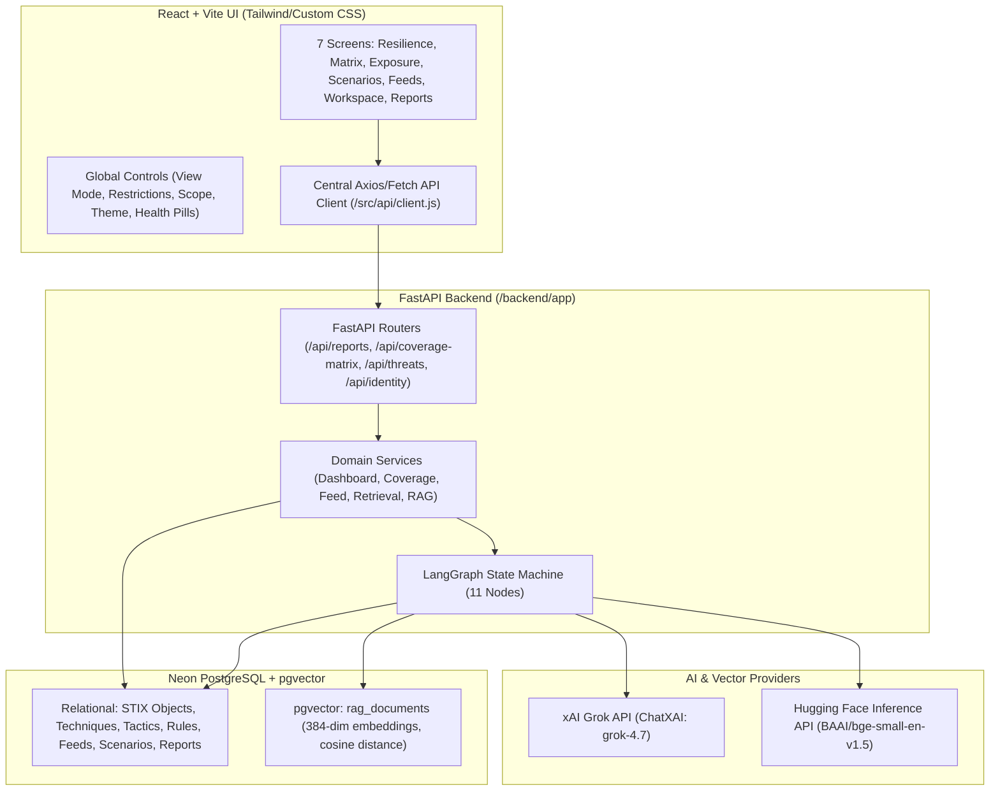

# ITDR Platform Implementation Plan

## 1. Project Overview & Objectives
The Identity Threat Detection & Response (ITDR) Platform is an enterprise-grade cybersecurity analysis application combining continuous security visibility, ATT&CK/D3FEND posture evaluation, and an explainable, stateful RAG pipeline.

### Core Objectives:
1. **Strategic & Tactical Dashboards**: Deliver all 7 screens specified in the ITDR Functional Specification Document v2.0 (Executive Resilience Dashboard, Coverage Matrix, Threat Exposure, Threat Scenarios, CTI Feeds, Threat Modeling Workspace, and Completed Intelligence Reports).
2. **Authoritative Knowledge Base**: Ingest MITRE ATT&CK Enterprise STIX 2.1 data and MITRE D3FEND defensive knowledge graph data into normalized relational tables and semantic RAG vectors.
3. **Stateful LangGraph RAG Workflow**: Implement an 11-node stateful analysis workflow using Grok via xAI API (`langchain-xai`) and Hugging Face feature extraction embeddings (`BAAI/bge-small-en-v1.5`), backed by Neon PostgreSQL with `pgvector`.
4. **Observable, Grounded Generation**: Ensure every technique candidate and defensive countermeasure has explicit citations to retrieved documents, transparent execution traces, and strict schema validation.
5. **Production-Ready & Interview-Grade Architecture**: Clean separation of routing, services, ORM, schemas, and AI graphs; comprehensive Alembic migrations, test suites, and documentation.

---

## 2. Architecture & Data Flow

---

## 3. Screen-to-API Mapping Matrix

| Screen | URL Route | Primary API Endpoints | Key Payloads & Responsibilities |
| :--- | :--- | :--- | :--- |
| **1. Identity Resilience Dashboard** | `/` or `/resilience` | `GET /api/reports/identity-resilience` `GET /api/reports/threat-exposure` | Coverage ring metric, ATT&CK tactic exposure bars (covered vs exposed), resilience quadrant scatter, critical blind spots list. |
| **2. ITDR Coverage Matrix** | `/coverage-matrix` | `GET /api/coverage-matrix` `GET /api/coverage-matrix/ttp-detail` | Scope toggle (Identity vs Enterprise), status filters (All, Covered, Gaps), tool filters (CrowdStrike, MDI, Okta, Wiz, In-house, Third-party), tactic columns, technique detail drawer. |
| **3. Identity Threat Exposure** | `/threat-exposure` | `GET /api/reports/threat-exposure` | TTPs sighted KPIs (total, covered, exposed), phase-grouped technique cards with sighting badges. |
| **4. Identity Threat Scenarios** | `/threat-scenarios` | `GET /api/reports/threat-scenarios` | 2D interactive resilience quadrant (Detection % vs Mitigation %), scrollable scenario list with status badges and source references. |
| **5. Threat Intelligence Feeds** | `/feeds` | `GET /api/identity/bulletins` `GET /api/identity/feeds` `POST /api/twin/feeds/ingest` | Feed KPIs, searchable CTI table, source status, ingest modal with backend SSRF/input validation. |
| **6. Threat Modeling Workspace** | `/threat-modeling` | `GET /api/threats/samples` `POST /api/threats/analyze` | 3-step AI workflow (Input advisory/sample → Select Model & Options → Telemetry, Trace & Report Stepper). |
| **7. Completed Reports** | `/reports` | `GET /api/identity/bulletins` `GET /api/threats/reports` `GET /api/threats/reports/{id}` | Searchable report library, detailed executive brief, evidence citations, defensive recommendations, export to Markdown/JSON. |

---

## 4. Database Entities & Relational Design

1. **MITRE ATT&CK Knowledge**:
   - `stix_objects`: STIX ID, object type, created, modified, revoked, deprecated, version, raw JSONB.
   - `tactics`: STIX ID, external ID (e.g. TA0001), name, short_name, description.
   - `techniques`: STIX ID, technique ID (e.g. T1078, T1098), name, description, url, is_subtechnique, parent_technique_id, platforms, is_identity_relevant.
   - `technique_tactic_map`: Association table linking techniques to tactics.
   - `attack_software`: Groups, malware, and tools from ATT&CK.
   - `technique_usage_procedures`: Relationship records mapping groups/software to technique IDs with procedure descriptions and citations.

2. **MITRE D3FEND Knowledge**:
   - `d3fend_techniques`: D3FEND ID (e.g. D3-UAC), name, definition, official URL, category/parent taxonomy.
   - `attack_defence_mappings`: Official relations between ATT&CK technique IDs and D3FEND technique IDs with provenance.

3. **RAG Vector Knowledge Base**:
   - `rag_documents`: Chunk ID, source_kind (`attack`, `d3fend`, `feed`), document_type, source_object_id, external_id, title, content, url, metadata JSONB, content_hash, embedding_model, embedding (`vector(384)`).

4. **ITDR Operational Data**:
   - `detection_rules`: Rule ID, name, tool/provider (CrowdStrike, MDI, Okta, Wiz, In-House, Third-Party), enabled status, client_restriction, itdr_scope, last_observed.
   - `detection_rule_techniques`: Many-to-many mapping between rules and ATT&CK techniques.
   - `threat_feeds`: Source, title, description, url, published_at, ingested_at, status, related_techniques JSONB.
   - `threat_scenarios`: Name, description, detection_rate, mitigation_rate, status, scope, source.
   - `threat_analysis_reports`: Report ID, advisory_text, report_title, executive_summary, severity, severity_rationale, structured_report JSONB, model_provider, completion_status, created_at.
   - `analysis_citations`: Report ID, cited source ID, external ID, url, excerpt, relevance_score, citation_role.
   - `analysis_trace_steps`: Report ID, step_name, status, started_at, completed_at, duration_ms, metadata JSONB, error_details.

---

## 5. Engineering Assumptions & Safeguards

1. **Neon pgvector & Database Connectivity**:
   - Production connects to Neon PostgreSQL with `sslmode=require`.
   - Vector operations check `SELECT 1 FROM pg_extension WHERE extname = 'vector'`. When pgvector is active, cosine distance operator `<=>` is used.
   - If running locally without pgvector installed, the vector store transparently falls back to python-based cosine similarity so development and tests never break, and the `/api/system/status` endpoint honestly reports the status.
2. **AI Provider Availability & Resiliency**:
   - Backend interfaces with Grok via `langchain-xai` (`ChatXAI`) and xAI API (`https://api.x.ai/v1`).
   - Embeddings use Hugging Face Inference API (`InferenceClient.feature_extraction` with `BAAI/bge-small-en-v1.5`).
   - If API keys are unconfigured or provider rates are exceeded, endpoints return structured degraded status rather than crashing or faking successful completion.
   - Unit tests use mock providers to ensure 0 paid network calls and deterministic CI execution.
3. **Data Integrity & Grounding**:
   - Seeded operational records are explicitly marked `DEMO DATA` in the UI and database.
   - ATT&CK/D3FEND references are extracted from real imported sources, never fabricated.

---

## 6. Implementation Milestones

- **Phase 0**: Plan & Architecture (Completed).
- **Phase 1**: Project Skeleton, Database Models, Session, Alembic Migrations, and System Health.
- **Phase 2**: ATT&CK STIX 2.1 & D3FEND Ingestion, Fixtures, and Demo Operational Data.
- **Phase 3**: RAG Document Builders, Hugging Face Embeddings, Neon pgvector Store, and Semantic Retrieval.
- **Phase 4**: LangGraph 11-Node Workflow, xAI Grok Integration, Structured Reports, Citations, and Trace Logging.
- **Phase 5**: Full React UI Implementation (Top Bar, Sidebar, 7 Screens, Modals/Drawers, Visualizations, Exporting).
- **Phase 6**: Verification, Automated Test Suite, Docs, and Developer Runbook.
