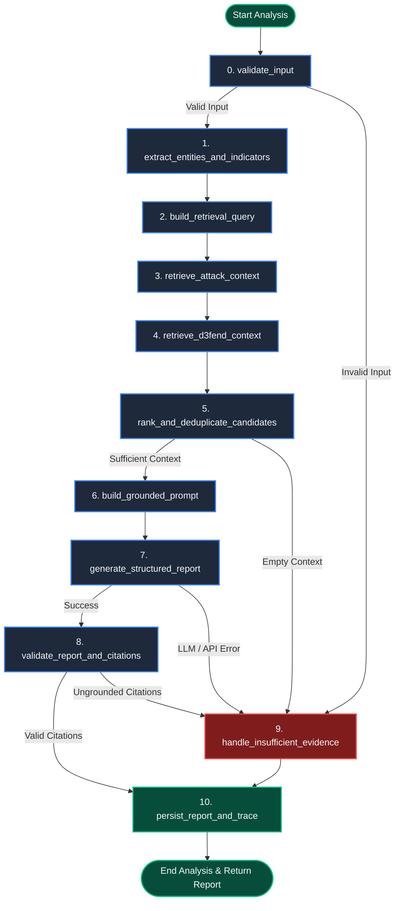

# LangGraph Threat Analysis Workflow

## Overview
The ITDR Platform orchestrates threat intelligence analysis through an **11-node stateful LangGraph workflow**. Rather than relying on rigid, opaque, single-prompt LLM chains, LangGraph provides deterministic state transitions, observable telemetry at every stage, explicit failure boundaries, and verifiable grounding.

---

## Complete Workflow Graph



---

## State Schema (`ThreatAnalysisState`)

The workflow maintains a strongly-typed state dictionary that flows between nodes:

```python
class ThreatAnalysisState(TypedDict):
    # Inputs
    threat_text: str
    title: Optional[str]
    model_name: str
    temperature: float
    source_feed_id: Optional[str]

    # Intermediate Extraction & Context
    extracted_indicators: Dict[str, List[str]]
    retrieval_query: str
    attack_candidates: List[Dict[str, Any]]
    d3fend_candidates: List[Dict[str, Any]]
    ranked_context: List[Dict[str, Any]]
    grounded_prompt: str

    # Generation & Evaluation
    raw_generation: Optional[Dict[str, Any]]
    validated_report: Optional[Dict[str, Any]]
    citations: List[Dict[str, Any]]
    is_valid: bool
    fallback_mode: bool
    error_message: Optional[str]

    # Observable Execution Telemetry
    trace_steps: List[Dict[str, Any]]
    db_session: Any  # Injected SQLAlchemy session for node persistence
```

---

## Detailed Node Specifications

### Node 0: `validate_input`
- **Purpose**: Validates length, formatting, and character hygiene of the submitted security advisory.
- **Input**: `threat_text` (minimum length: 15 characters).
- **Execution**: Checks for empty strings, whitespace-only content, and maximum length safety limits.
- **Next Transition**:
  - `threat_text >= 15 chars` $\rightarrow$ Node 1 (`extract_entities_and_indicators`).
  - `threat_text < 15 chars` $\rightarrow$ Node 9 (`handle_insufficient_evidence_or_model_error`).

### Node 1: `extract_entities_and_indicators`
- **Purpose**: Extracts explicit MITRE technique IDs, Common Vulnerabilities and Exposures (CVEs), IP addresses, file hashes, and security keywords using regex.
- **Regex Patterns**:
  - ATT&CK ID: `\b(T\d{4}(?:\.\d{3})?)\b`
  - CVE: `\b(CVE-\d{4}-\d{4,7})\b`
  - Security Keywords: Kerberos, Golden Ticket, DCSync, LSASS, Pass-the-Hash, OAuth, MFA, Azure AD, SAML.
- **Output**: Populates `extracted_indicators = {"ttps": [...], "cves": [...], "keywords": [...]}`.

### Node 2: `build_retrieval_query`
- **Purpose**: Synthesizes an optimized semantic search query combining extracted indicators and core advisory narrative snippets.
- **Output**: `retrieval_query` string for Hugging Face vectorization.

### Node 3: `retrieve_attack_context`
- **Purpose**: Executes hybrid retrieval against `rag_documents`.
- **Logic**:
  1. Guaranteed retrieval for explicitly extracted `ttps`.
  2. Top-K nearest neighbor semantic cosine distance query in Neon pgvector.
  3. Joins against `detection_rules` to determine whether active EDR/SIEM rules currently cover each technique.
- **Output**: `attack_candidates` list with metadata, coverage status, and similarity scores.

### Node 4: `retrieve_d3fend_context`
- **Purpose**: Enriches candidate ATT&CK techniques with official defensive countermeasures from MITRE D3FEND.
- **Logic**: Queries `d3fend_mappings` in PostgreSQL for each candidate technique to discover mapped defensive countermeasures (e.g. `D3-MFA`, `D3-SPTA`, `D3-DLMA`).
- **Output**: `d3fend_candidates` list.

### Node 5: `rank_and_deduplicate_candidates`
- **Purpose**: Eliminates duplicate techniques, fuses scores, and applies confidence threshold gating.
- **Logic**:
  - Explicit IDs received an exact boost score of `1.0`.
  - Semantic vector matches are retained if similarity exceeds threshold (`>= 0.40`).
- **Next Transition**:
  - Non-empty candidates $\rightarrow$ Node 6 (`build_grounded_prompt`).
  - Zero candidates found $\rightarrow$ Node 9 (`handle_insufficient_evidence_or_model_error`).

### Node 6: `build_grounded_prompt`
- **Purpose**: Constructs a strict, zero-shot structured generation prompt with injected candidate context and output constraints.
- **Constraints Injected**:
  - Candidate ATT&CK techniques catalogue.
  - Candidate D3FEND countermeasures catalogue.
  - Required JSON schema format with fields: `executive_summary`, `threat_actor`, `overall_risk_score`, `confidence_score`, `identified_ttps`, `recommended_d3fend`, `immediate_actions`, `strategic_actions`, `citations`.

### Node 7: `generate_structured_report`
- **Purpose**: Calls the LLM to generate the threat report.
- **LLM Provider**: **xAI Grok-4.7** via `ChatXAI` from `langchain-xai`.
- **Fallback Handling**: If `XAI_API_KEY` is unconfigured or the network endpoint is unreachable, executes deterministic rule-based threat synthesis.
- **Next Transition**:
  - Successful JSON parse conforming to schema $\rightarrow$ Node 8 (`validate_report_and_citations`).
  - Parsing failure or timeout $\rightarrow$ Node 9 (`handle_insufficient_evidence_or_model_error`).

### Node 8: `validate_report_and_citations`
- **Purpose**: Strictly enforces citation grounding and eliminates hallucinations.
- **Logic**:
  - Compares every technique ID cited in `identified_ttps` against the verified `ranked_context` list.
  - If the LLM referenced an ATT&CK ID not present in the candidate set, the ungrounded citation is logged and stripped.
  - Verifies risk scores and confidence bounds.
- **Output**: `validated_report` and `citations`.

### Node 9: `handle_insufficient_evidence_or_model_error`
- **Purpose**: Resilient exception handler ensuring the user receives an actionable, honest report rather than an unhandled 500 error.
- **Logic**: Generates a degraded-mode report detailing why analysis could not be completed (e.g. insufficient input text, unmapped threat vectors, or provider unavailability), and recommends immediate manual review steps.

### Node 10: `persist_report_and_trace`
- **Purpose**: Transactionally writes completed records to PostgreSQL.
- **Tables Updated**:
  - `threat_analysis_reports`: Core report metadata and JSON payloads.
  - `analysis_citations`: Individual citation rows.
  - `analysis_trace_steps`: All 11 trace steps with latency, node name, status, and input/output parameters.
- **Output**: Committed `report_id` returned to API caller.

---

## Observable Telemetry & Trace Stepper

Every step executed in the LangGraph graph records a high-resolution telemetry record:
```json
{
  "step_index": 3,
  "node_name": "retrieve_attack_context",
  "status": "success",
  "latency_ms": 28.4,
  "input": {
    "extracted_ttps": ["T1078.004", "T1003.001"],
    "retrieval_query": "Adversaries abused valid cloud credentials and performed memory injection..."
  },
  "output": {
    "candidate_count": 8,
    "top_candidates": ["T1078.004", "T1003.001", "T1003.006"]
  }
}
```
This payload is rendered directly in the **Threat Modeling Workspace** and **Completed Reports** screens as an interactive **Trace Stepper**, enabling security analysts to audit the AI's internal reasoning process at every stage.
