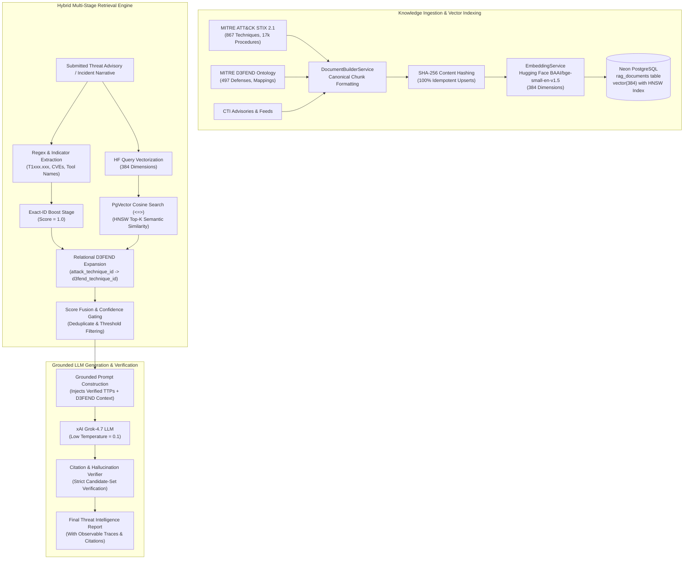

# ITDR RAG Architecture & Retrieval Deep Dive

## Introduction
The Retrieval-Augmented Generation (RAG) layer in the ITDR Platform is designed specifically for high-assurance cybersecurity threat modeling. In security operations, hallucinations (e.g. inventing non-existent ATT&CK IDs or recommending irrelevant security controls) destroy analyst trust. 

This document explains the end-to-end RAG architecture, from STIX knowledge ingestion to vector storage in Neon PostgreSQL, hybrid retrieval, prompt grounding, and hallucination verification.

---

## RAG Architectural Pipeline



---

## 1. Knowledge Document Construction & Provenance

Generic chunking algorithms (like fixed-length 500-token character chunking) fail in cybersecurity because they slice apart crucial relationships between technique IDs, tactic names, platform targets, and execution procedures.

The platform uses **Domain-Aware Semantic Document Synthesis** via `DocumentBuilderService`:

### Canonical Document Templates
Every MITRE ATT&CK technique is transformed into a structured textual document:
```text
MITRE ATT&CK Technique T1078.004: Valid Accounts: Cloud Accounts
Tactics: Initial Access, Defense Evasion, Persistence, Privilege Escalation
Identity Relevance: Active Directory, Cloud IAM, OAuth, SAML, Federated Tokens
Platforms: Azure AD, AWS IAM, GCP, SaaS Applications
Detection Difficulty: Moderate

Description:
Adversaries may obtain and abuse credentials of cloud accounts to gain access to cloud environments. Cloud accounts may be compromised through credential stuffing, phishing, or accessing token caches.

Procedures & In-the-Wild Usage:
- Scattered Spider obtained session cookies to authenticate to cloud management portals.
- APT29 utilized valid service principal credentials to execute directory enumeration.
```

### Idempotency via SHA-256 Content Hashing
Before upserting into `rag_documents`, each document's canonical text is hashed:
$$\text{hash} = \text{SHA256}(\text{source\_id} + \text{content})$$
If a document with the identical hash already exists in the database, re-embedding is skipped. This prevents unnecessary Hugging Face API consumption and guarantees idempotent indexing runs.

---

## 2. Embedding Model: BAAI/bge-small-en-v1.5

- **Provider**: Hugging Face Inference Providers / Inference API.
- **Model**: `BAAI/bge-small-en-v1.5`.
- **Dimensions**: 384 float32 numbers.
- **Why this model?**
  - Consistently ranks at the top of the MTEB (Massive Text Embedding Benchmark) for retrieval tasks in its size class.
  - Generates compact 384-dimensional embeddings, which reduces RAM and index size in Neon PostgreSQL by **75%** compared to 1536-dimensional models (e.g. OpenAI text-embedding-ada-002), without sacrificing semantic retrieval accuracy.
  - Operates efficiently with low latency across cloud inference endpoints.

---

## 3. Storage & Neon pgvector Indexing

In PostgreSQL / Neon, vectors are stored in the `rag_documents` table:
```sql
CREATE TABLE rag_documents (
    id UUID PRIMARY KEY,
    source_id VARCHAR(64) NOT NULL,
    source_kind VARCHAR(50) NOT NULL,
    title VARCHAR(512) NOT NULL,
    content TEXT NOT NULL,
    metadata JSONB,
    content_hash VARCHAR(64) UNIQUE NOT NULL,
    embedding vector(384)
);
```

### Cosine Distance and HNSW Indexing
On Neon, we leverage native HNSW (Hierarchical Navigable Small World) indexing using the cosine operator:
```sql
CREATE INDEX ix_rag_documents_embedding_hnsw 
ON rag_documents 
USING hnsw (embedding vector_cosine_ops)
WITH (m = 16, ef_construction = 64);
```
Cosine similarity is computed as:
$$\text{Cosine Similarity} = 1 - (\text{embedding}_A \Leftrightarrow \text{embedding}_B)$$
Where `<=>` is the pgvector cosine distance operator.

### Dual-Mode Execution Strategy
To guarantee developer experience and robust test execution even when running against a local PostgreSQL instance that lacks compiled C extensions:
1. **Neon Cloud Mode**: Executes native SQL queries with `<=>` cosine distance.
2. **Local Resilient Fallback**: Stores vectors as JSON arrays and computes cosine similarity in memory using NumPy dot products. The application detects the presence of the `vector` extension at startup and logs its operational mode transparently via `/api/system/status`.

---

## 4. Multi-Stage Hybrid Retrieval Engine

A standard vector search alone often misses exact ATT&CK IDs when an advisory explicitly mentions `T1078.004` because semantic models embed strings into broad semantic concepts rather than preserving exact alphanumeric tokens.

The platform implements a **4-Stage Hybrid Retrieval Pipeline**:

### Stage 1: Explicit Entity Extraction
The retrieval engine parses the input text with high-precision regular expressions:
```python
ATTACK_ID_PATTERN = re.compile(r"\b(T\d{4}(?:\.\d{3})?)\b", re.IGNORECASE)
```
Identified IDs are flagged for deterministic boosting.

### Stage 2: Exact-ID Candidate Boosting
Techniques directly named in the threat advisory are fetched immediately with a relevance score of `1.0`. They are guaranteed a spot in the retrieved context window, preventing semantic drift.

### Stage 3: Semantic Cosine Similarity
The advisory narrative is vectorized through Hugging Face, and a Top-K nearest neighbor query searches `rag_documents` for semantically related techniques (e.g., matching "dumping memory from the Windows auth subsystem" to `T1003.001 - OS Credential Dumping: LSASS Memory`, even if the string "T1003.001" never appeared).

### Stage 4: Relational Graph Expansion
For all retrieved ATT&CK techniques, the database executes an inner join on `d3fend_mappings` to retrieve official D3FEND defensive countermeasures (e.g. `D3-MFA`, `D3-SPTA`) and checks `detection_rule_techniques` to ascertain current enterprise detection rule coverage.

---

## 5. Grounded Prompting & Anti-Hallucination Engine

### Prompt Injection Guardrails
The retrieved context is injected into a strict system prompt provided to **xAI Grok-4.7**:
```text
You are an expert Identity Threat Detection & Response (ITDR) analyst.
Analyze the following security advisory using ONLY the verified ATT&CK and D3FEND context provided below.

RULES:
1. Only reference ATT&CK technique IDs that are present in the VERIFIED CANDIDATE SET.
2. Do not invent T-IDs or D3FEND countermeasures.
3. Every recommendation must link to a specific identified technique.
4. Output must strictly conform to the provided JSON schema.
```

### Post-Generation Citation Verification
Before persisting the report, the workflow executes a verification check:
```python
valid_technique_ids = {c["source_id"] for c in candidate_context}
verified_citations = []
for citation in generated_report.citations:
    if citation.source_id in valid_technique_ids:
        verified_citations.append(citation)
    else:
        logger.warning(f"Stripped ungrounded hallucinated citation: {citation.source_id}")
```
This multi-layered defense guarantees that every cited technique and recommended countermeasure in the finished intelligence report is verifiable against the active knowledge base.
